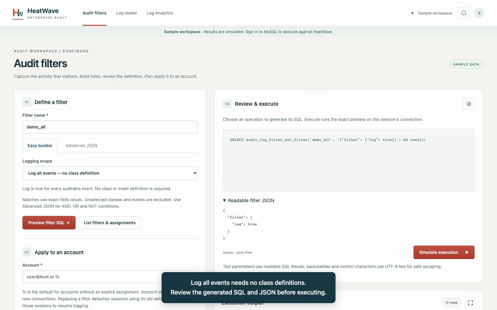

# HeatWave Enterprise Audit Demo

A Flask application for configuring MySQL Enterprise Audit on HeatWave, reading audit events, and turning audit JSON into database views. Every operation provides a SQL preview and an explicit execution button.

[Watch the demo](demo/README.md) · [Setup instructions](#setup)

[](demo/README.md)

## Setup

### Requirements

- Python **3.12 or newer**, with `pip` and `venv`.
- Git to clone the repository.
- For live use: network access from the application host to a HeatWave MySQL database, a MySQL account, and the required audit privileges. A database is optional for the sample workspace.

### Install and start

Run these commands in a terminal on macOS or Linux:

```sh
git clone https://github.com/ivanxma/HeatWave_Audit_Demo.git
cd HeatWave_Audit_Demo
python3 --version
python3 -m venv .venv
.venv/bin/python -m pip install -r requirements.txt
.venv/bin/python app.py
```

For an existing checkout, start with the `python3 --version` command from its root folder. If your default Python is older than 3.12, use a newer interpreter, such as `python3.12`, when creating the virtual environment.

On Windows PowerShell, use:

```powershell
git clone https://github.com/ivanxma/HeatWave_Audit_Demo.git
cd HeatWave_Audit_Demo
py -3 -m venv .venv
.\.venv\Scripts\python.exe --version
.\.venv\Scripts\python.exe -m pip install -r requirements.txt
.\.venv\Scripts\python.exe app.py
```

Verify that the Windows interpreter is Python 3.12 or newer before installing. The commands above do not require activating the virtual environment.

Open **http://127.0.0.1:5055**. Stop the application with **Ctrl+C**.

### Explore without a database

Choose **Open sample workspace** on the login page. It simulates filter creation, account assignment, log reads and view queries. Sample results are clearly labeled and do not execute SQL or connect to a database.

### Connect to HeatWave

1. Open **Create profile** on the login page.
2. Enter a profile name, the MySQL hostname and port, and a TLS mode. TCP connections default to **REQUIRED**. For certificate and hostname verification, choose **VERIFY_IDENTITY** and supply the CA file path on the application server when needed.
3. Enter your MySQL username and password, then choose **Create profile & connect**. The connection is verified before saving the profile.
4. On later visits, select the saved profile in **Sign in** and enter your MySQL credentials again.

Profiles store connection defaults, never passwords. Runtime profiles are saved under Git-ignored `generated/profiles.json`. Live credentials and connection objects remain in server memory; the browser cookie contains only an opaque session ID.

HeatWave must support Enterprise Audit. OCI documentation specifies MySQL 8.0.34-u2 or later for this capability. Filter administration requires `AUDIT_ADMIN`; reading and view operations require the corresponding privileges on your server. Log reading requires JSON audit format. The application does not install plugins, grant privileges or modify OCI resources.

## Using the application

### Audit filters

- **Log all events** produces `{"filter":{"log":true}}` without class definitions.
- **Only matching class rules** starts with `log:false` and enables selected classes/subclasses. Match exact field values, or use Advanced JSON for compound conditions.
- **Disable all logging** produces `{"filter":{"log":false}}`.
- Preview and save the filter, then assign it to `user@host`, or `%` as the default for accounts without an explicit assignment.
- Use **List filters & assignments** to inspect the current setup.

New connections pick up account assignments. Replacing a filter detaches sessions using its previous definition; reconnect those sessions to resume logging. The app discovers `audit_log_database` after login, with `mysql_audit` as the HeatWave fallback.

### Log reader

Choose the current server bookmark, a starting timestamp, or an exact timestamp and event ID. Set the buffer between **32,768 and 4,194,304 bytes**, choose the maximum events, preview the SQL and execute.

Bookmark reads capture the bookmark, add the event limit to a text session variable, show the resolved arguments, then call `audit_log_read()`. **Read next** continues on the same physical MySQL connection. **Close sequence** closes it. Reading past the end may require starting a new sequence.

Output tabs distinguish **Audit events**, **Reader arguments**, and **Raw JSON**. Audit events is a table representation of the returned JSON, not an additional SQL result set. The count shows events without counting the JSON wrapper and argument rows again.

### Log Analytics

Load accessible databases or create one, select a view name, and choose a rolling lookback (90 seconds by default) or a fixed starting timestamp. Visually select columns by name, SQL type, JSON path and event class. Preview and execute **Create view**, then **Read saved view**. Replacing an existing view requires an explicit checkbox.

The view uses `JSON_TABLE` and `SQL SECURITY INVOKER`. It reads one buffer-limited batch and does not store a permanent audit history. A rolling view recalculates its start time on every SELECT. **Read saved view** applies the selected session buffer before reading. Use a direct continuation query to read subsequent batches rather than restarting the window.

View definitions cannot refer to session variables such as `@lastsec`; validated numeric durations or timestamp literals are embedded in the SQL instead. Existing views retain their definitions until explicitly replaced.

### Working with results

- Search, sort, page and export the returned rows.
- Drag column headers to reorder them and their right edges to resize them; reset the saved layout with the reset icon.
- Click a cell to inspect its full value.
- Use the maximize icon beside **Execution output** to expand the panel. Restore it with the same button or **Escape**. Tabs, searches and paging are preserved.
- The notification bell beside the user control retains the last 30 action messages in the session. Clear notifications independently from dismissing message banners.

## Configuration and hosting

The default listener is loopback on port 5055. For example, select another local port before starting:

```sh
export AUDIT_PORT=5056
.venv/bin/python app.py
```

`AUDIT_BIND` changes the listening address. Use HTTPS for access beyond your own machine. For shared hosting, use a production WSGI server with **one worker process** and multiple threads; credentials and live reader connections are held in process memory. Multiple independent workers do not share sessions. Restarting signs users out. Sessions expire after 60 minutes by default, and expired connections are closed on the next request.

Set `AUDIT_COOKIE_SECURE=1` when serving through HTTPS. `AUDIT_SECRET_KEY` supplies the session signing key through the environment.

Private JSON configuration is selected with `AUDIT_CONFIG_FILE`:

```sh
mkdir -p internal_doc
cp config.example.json internal_doc/config.json
# Edit internal_doc/config.json for this deployment.
export AUDIT_CONFIG_FILE="$PWD/internal_doc/config.json"
.venv/bin/python app.py
```

Supported settings include `DEMO_ENABLED`, `SESSION_TTL` in seconds, `PROFILE_STORE` as an absolute server-side path, and Flask `SECRET_KEY` / `SESSION_COOKIE_SECURE`. Keep private configuration in ignored `internal_doc/` or outside the checkout. Do not put passwords or deployment details in public files.

## Audit JSON mappings

Missing class-specific fields return SQL NULL. Timestamps use `DATETIME` to preserve the audit timestamp; IDs use `BIGINT UNSIGNED`.

| Column | JSON path |
| --- | --- |
| `ts` / `tsid` | `$.timestamp` / `$.id` |
| `status` | `$.connection_data.status` |
| `connection_type` | `$.connection_data.connection_type` |
| `c_client_name` | `$.connection_data.connection_attributes._client_name` |
| `c_client_version` | `$.connection_data.connection_attributes._client_version` |
| `command` / `sql_command` | `$.general_data.command` / `$.general_data.sql_command` |
| `command_status` | `$.general_data.status` |
| `query` | `$.general_data.query` |
| `table_database` / `table_name` | `$.table_access_data.db` / `$.table_access_data.table` |

Account/login columns and table-access query columns are also available in the visual selector. Filter match field names are a separate API from the event JSON paths. The rolling Analytics window uses UTC; fixed timestamps must use the audit log's time zone.

## Troubleshooting

- **Cannot connect:** check reachability from the application host, MySQL port, credentials, TLS mode and CA file permissions. A successful browser connection to the app does not establish database reachability.
- **No events:** check audit configuration and filter assignments, generate activity from a new audited connection, and try a timestamp before that activity. A current bookmark starts at the most recent event.
- **MySQL 3200:** inspect the displayed audit UDF reason and failed statement number. Error 3200 wraps a server-side function error; it does not by itself prove a column mapping problem. Sensitive values are redacted from diagnostic text.
- **Missing large events:** increase the buffer and restart from an earlier position. MySQL can skip events larger than the read buffer; review returned warning codes.
- **Connection lost or app restarted:** sign in again and start a new read sequence. The app does not silently replace reader connections.
- **View still uses older SQL:** select the database/view, enable **Replace view if it already exists**, preview and recreate it.

## Validation

```sh
.venv/bin/python -m py_compile app.py modules/*.py
.venv/bin/python -m unittest discover -s tests -v
.venv/bin/python -m pip check
```

Tests cover SQL generation, JSON mappings, read positions and limits, session/CSRF isolation, single-use previews, credential handling, TLS and connection cleanup. Browser checks cover sample workflows, output tabs, event counts and maximized results. Generated view SQL has also been checked on isolated local MySQL using fixture data. These checks do not establish live HeatWave plugin behavior or privileges.

## Documentation

- [OCI HeatWave Enterprise Audit](https://docs.oracle.com/en-us/iaas/mysql-database/doc/mysql-enterprise-audit-plugin.html)
- [JSON audit event format](https://dev.mysql.com/doc/refman/8.4/en/audit-log-file-formats.html)
- [Filter definitions](https://dev.mysql.com/doc/refman/8.4/en/audit-log-filter-definitions.html)
- [Reading audit logs](https://dev.mysql.com/doc/refman/8.4/en/audit-log-file-reading.html)
- [Audit functions and buffer limits](https://dev.mysql.com/doc/refman/8.4/en/audit-log-reference.html)
- [CREATE VIEW](https://dev.mysql.com/doc/refman/8.4/en/create-view.html) and [JSON_TABLE](https://dev.mysql.com/doc/refman/8.4/en/json-table-functions.html)
